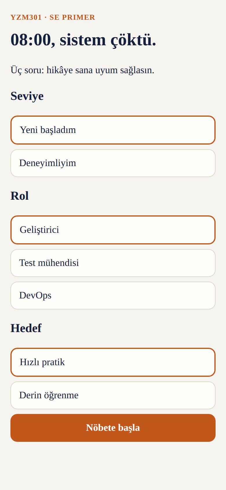
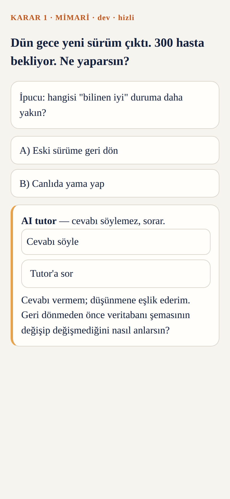
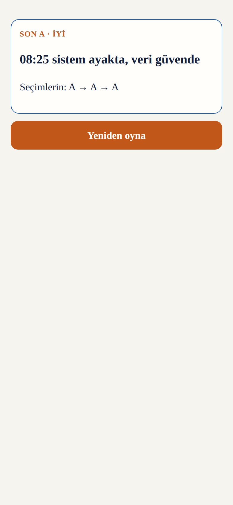

# SE Primer

🇬🇧 English · [🇹🇷 Türkçe](README.tr.md)

> An adaptive, choice-driven story for software engineering students: **the player decides, the app shows the technical consequence.** Inspired by the "Primer" from *The Diamond Age*. Course project for YZM301.

| Intro | Scene | Ending |
|---|---|---|
|  |  |  |

## Links
- **Live app:** AI Studio link: `[ADD LINK]`
- **Demo video (60 s):** `[ADD LINK]` (also in this repo: [`demo/se-primer-demo.mp4`](demo/se-primer-demo.mp4))

## What it does
- **3 onboarding questions** (level, role, goal) adapt the experience:
  - *Beginner* → a hint on every decision.
  - *Experienced* → a 60-second timer, no hints.
- **One healthcare scenario:** "08:00, the appointment system is down. You are on call." Three decisions (Architecture, Testing, KVKK/privacy), two endings (good / bad).
- After every choice: **what happened and why**.
- **AI tutor** gives hints as questions and never reveals the answer.

## Quick start
```bash
npm install
npm start            # http://localhost:8080 (open on your phone via your LAN IP)
npm run cy:run       # Cypress E2E, records video to cypress/videos/
npm run eval         # tutor evaluation (35 inputs)
```

## Repository map
| File | Purpose |
|---|---|
| [`spec.md`](spec.md) | Problem, scope, success criteria, 6 acceptance examples, state machine |
| [`DESIGN.md`](DESIGN.md), [`design/`](design/) | Design tokens and the 3 mobile screens |
| [`index.html`](index.html) | The app (single file, mobile-first) |
| [`eval.js`](eval.js), [`eval.md`](eval.md) | Tutor evaluation: method, results, honest limits |
| [`cypress/e2e/primer.cy.js`](cypress/e2e/primer.cy.js) | E2E tests: all 3 paths, personalization, tutor |
| [`tutor-llm.js`](tutor-llm.js), [`AI_STUDIO.md`](AI_STUDIO.md) | Optional LLM tutor mode and AI Studio migration steps |

## Tutor evaluation (summary)
| Set | n | Result |
|---|---|---|
| Development | 20 | 20/20 (v1 was 14/20) |
| Held-out | 10 | 10/10 (4 not fully independent, see `eval.md`) |
| Stress | 5 | 1/5 |

Answer leakage: **0/35**. Implicit approval: **0/35**. The stress set exposed 4 intent-recognition failures (no leak), all documented in [`eval.md`](eval.md).

## Product decisions: 3 features I did NOT build
1. **User accounts and saved progress:** the week's goal was proving the game loop and tutor safety, not persistence.
2. **A second scenario/chapter:** testing three paths end to end is worth more than more content.
3. **Teacher dashboard and analytics:** first prove a student can finish alone.

## Known limitations
- Default tutor is rule-based (deterministic, so the eval is repeatable); LLM mode is provided but untested offline.
- Hand labels in the eval were assigned by the author; review `eval-results.json` before trusting them.
- Demo video was recorded with a Playwright script that follows the same paths as the Cypress tests.

## References
Stephenson, *The Diamond Age* (1995) · GitHub Spec Kit · Google Stitch / AI Studio · Cypress docs · Law No. 6698 (KVKK).
