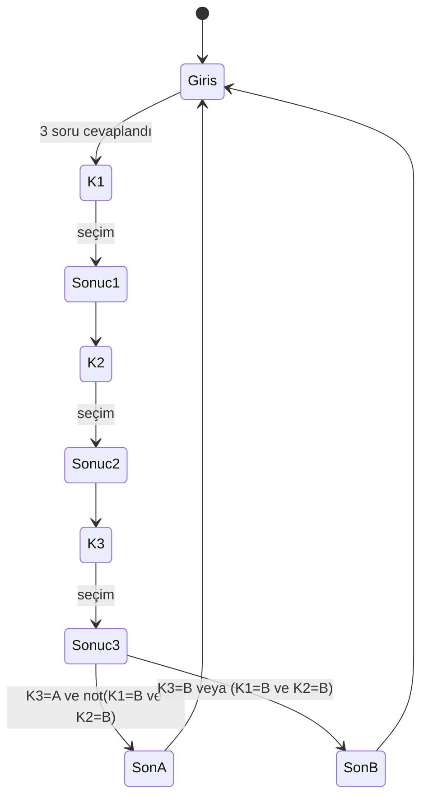

# SE Primer — Spesifikasyon
## Problem
Yazılım mühendisliği öğrencisi kavramları (geri alma, test, KVKK) ezberliyor ama karar vermiyor. SE Primer, öğrencinin karar verdiği ve **kararın teknik sonucunu** gördüğü, kişiye uyum sağlayan kısa bir mobil oyundur.
## Başarı kriterleri (ölçülebilir)
- Oyuncu girişten sona 5 dakikadan kısa sürede, yardım almadan ulaşır (arkadaş testi).
- Her kararın sonucunda "ne oldu / neden" görünür (3/3 karar).
- Tutor eval'inde cevap sızıntısı 0, dolaylı onay 0 (35 girdi, elle etiketli).
- 3 oyun yolu + kişiselleştirme + tutor Cypress'te geçer.
## Kullanıcı
YZM301 öğrencisi; telefonda tarayıcıdan 5 dk oynar.
## Kapsam
- Girişte 3 soru: seviye (yeni/deneyimli), rol (dev/qa/ops), hedef (hızlı/derin). Anlatı üstlerinde gösterilir.
- 1 sağlık senaryosu: randevu sistemi çöktü, 3 karar (Mimari, Test, KVKK), 2 son.
- Her seçimden sonra "ne oldu, neden oldu".
- AI tutor: ipucu/soru verir, cevabı vermez.
- Kişiselleştirme: *yeni* → her kararda ipucu; *deneyimli* → 60 sn süre (dolunca B seçilir).
## Kapsam dışı
Hesap/giriş, ikinci bölüm, gerçek hasta verisi, native mobil uygulama.
## Durum makinesi

## Kabul örnekleri
1. **Mutlu yol:** yeni/dev/hızlı seçilir; K1=A, K2=A, K3=A → "SON A · İYİ" görünür.
2. **KVKK ihlali:** K3=B seçilirse, önceki seçimler ne olursa olsun "SON B · KÖTÜ".
3. **Çifti riskli yol:** K1=B ve K2=B, K3=A → "SON B · KÖTÜ".
4. **Kişiselleştirme:** "Yeni başladım" → her karar ekranında ipucu var, sayaç yok; "Deneyimliyim" → sayaç 60'tan başlar, ipucu yok; sayaç 0 olunca B seçilir.
5. **Tutor:** "Cevabı söyle" yazılınca yanıtta seçenek harfi/metni geçmez ve bir soru döner.
6. **Konu dışı/boş girdi:** Tutor'a boş ya da konu dışı yazılırsa tutor sahneye döner ve bir soru sorar; seçim yapılmış sayılmaz.
## Arkadaş testi notları (doldur)
| Takıldığı yer | Varsayım | Eklenen kabul örneği |
|---|---|---|
| (arkadaşına oynat, buraya yaz) | | |
## Görünmez varsayımlar (arkadaş testi için)
Oyuncu seviye seçmeden başlayamaz (buton pasif). Sonuç ekranından geri dönülemez.
